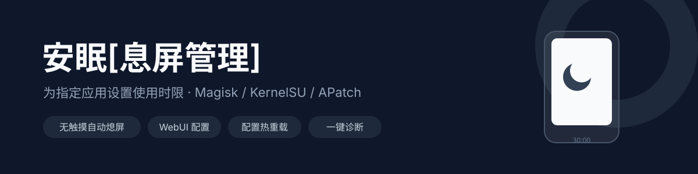
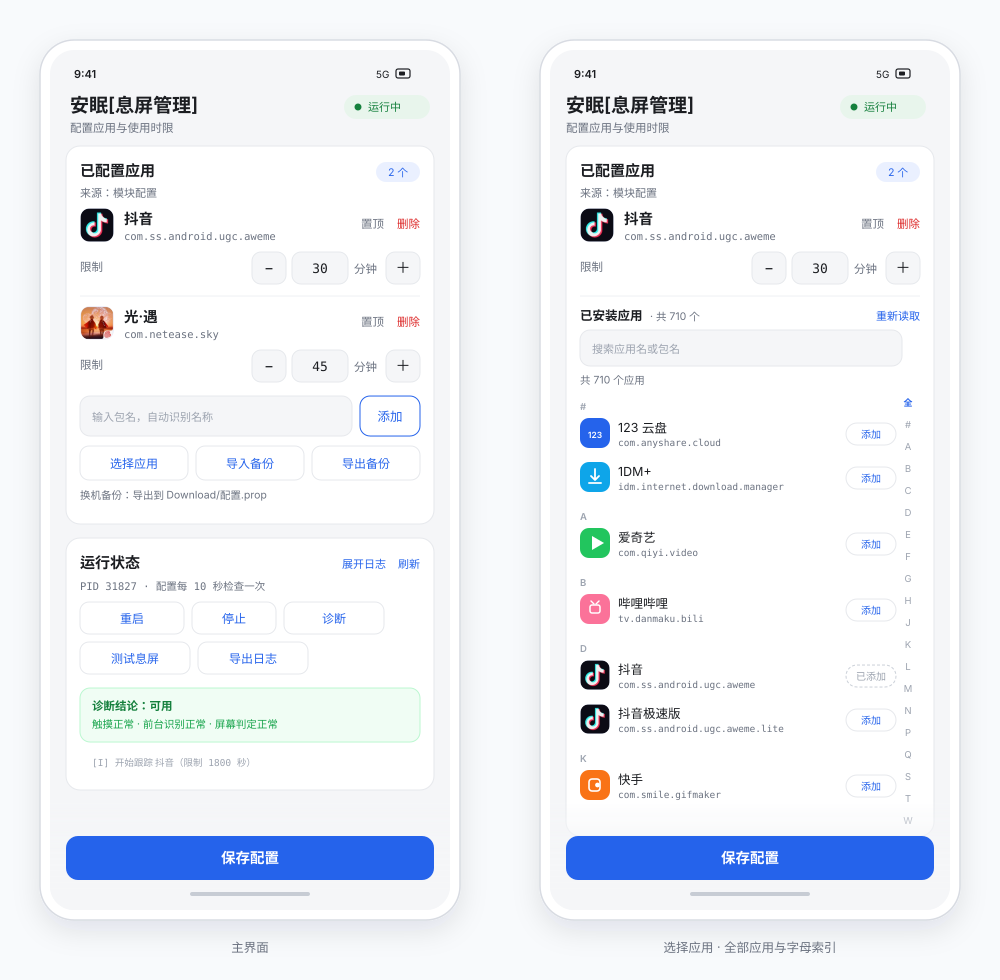
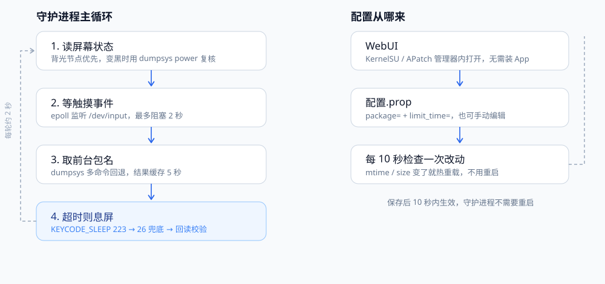

<div align="center">  
    
</div>

<h1 align="center">安眠[息屏管理]</h1>

<p align="center">为指定应用设置使用时限，连续无触摸操作时自动熄屏。</p>

<p align="center">  
    
    
    
    
</p>

---

## 简介

短视频类应用需要持续滑动操作，而系统自带的屏幕超时机制基于全局无操作判定，在观看过程中不会触发，容易出现"观看中入睡、屏幕整夜常亮"的情况。

本模块针对这一场景：仅对用户指定的应用计时，当该应用位于前台且连续 N 分钟未检测到触摸事件时，主动关闭屏幕。检测到触摸后计时立即重置。

## 功能

| 功能       | 说明                                      |
| -------- | --------------------------------------- |
| 按应用独立计时  | 每个应用单独配置时限，取值范围 1–180 分钟                |
| 触摸检测     | 监听 `/dev/input` 输入设备，触摸即重置计时            |
| 内置 WebUI | 在 KernelSU / APatch 管理器中直接打开，无需安装额外应用   |
| 应用选择     | 列出全部应用，按首字母分组，右侧 A–Z 索引筛选，点一行即可加入       |
| 名称与图标    | 优先使用管理器原生接口，不支持时解析 APK 资源并缓存，只识别一次      |
| 配置热重载    | 保存后 10 秒内自动生效，无需重启设备                    |
| 备份迁移     | 导出 / 导入 `/sdcard/Download/配置.prop`，换机直接拷贝 |
| 自动诊断     | 输出可用性结论，并指明缺失环节                         |
| 息屏测试     | 立即执行一次完整息屏流程，验证按键注入是否被系统拦截              |
| 诊断报告     | 「诊断版」安装包专属，一键收集完整环境信息，便于反馈           |
| 依赖精简     | 纯 C 二进制与 shell 脚本，不依赖 Xposed、无障碍服务或常驻应用 |

## 界面

<div align="center">  
    
</div>

WebUI 随模块一同安装，入口文件为 `webroot/index.html`：

- **KernelSU / APatch**：在管理器中打开本模块即可进入。
- **Magisk**：管理器本身不提供 WebUI，需配合 [WebUI X](https://github.com/MMRLApp/WebUI-X-Portable) 使用；也可通过模块的「操作」按钮查看状态、配置与近期日志。

## 工作原理

<div align="center">  
    
</div>

守护进程常驻运行，单轮循环约 2 秒，依次执行以下步骤：

1. **屏幕状态检测**：优先读取背光节点；当状态由亮转为灭时，再以 `dumpsys power` 复核，避免单次读取异常导致计时被清零。
2. **触摸事件监听**：通过 `epoll` 监听 `/dev/input/event*`，最长阻塞 2 秒。若无法读取任何输入设备，模块将暂停自动熄屏，避免误熄屏。
3. **前台应用识别**：依次尝试多条 `dumpsys window` / `dumpsys activity` 命令，结果缓存 5 秒。状态栏、输入法、系统弹窗获得焦点时不计为离开应用；持续离开超过 30 秒才重置计时。
4. **执行熄屏**：优先发送 `KEYCODE_SLEEP`（223，仅休眠，不会点亮已熄灭的屏幕），老版本系统回退至电源键（26），发送后重新读取背光以确认结果。

所有时间计算基于 `CLOCK_MONOTONIC`，不受系统时间调整影响。

## 安装

**环境要求**

- Android 8.0 及以上
- Magisk、KernelSU 或 APatch

**步骤**

1. 从 [Releases](../../releases) 下载安装包（管理器内的更新检查走 GitHub Pages 直链，国内网络无需代理）。
2. 在 Magisk / KernelSU / APatch 中刷入并重启设备。
3. 打开 WebUI，或直接编辑 `/data/adb/modules/anmian_screen_off/配置.prop`。
4. 添加应用、设置时限并保存。

Releases 提供两个变体，功能完全相同，按需选择其一：

- **标准版** `anmian-screen-off-2.6.1.zip`：日常使用推荐，不含详细诊断。
- **诊断版** `anmian-screen-off-diag-2.6.1.zip`：额外支持一键生成完整环境诊断报告，遇到问题机型时使用；更新走独立更新源，不会被自动替换成标准版。

## 配置

### 通过 WebUI

点「选择应用」打开应用列表：全部应用按拼音首字母分组，右侧 A–Z 索引可直接筛选，点一行即加入，默认时限 30 分钟，可用 `－` `＋` 或直接输入调整。名称与图标会自动识别并缓存在模块目录，只识别一次；也可以直接在输入框手动填写包名。

换机时点「导出备份」，当前列表会写入 `/sdcard/Download/配置.prop`，拷到新机器后点「导入备份」即可。修改完成后点击底部「保存配置」，10 秒内生效。

### 常见应用包名

| 应用    | 包名                              |
| ----- | ------------------------------- |
| 抖音    | `com.ss.android.ugc.aweme`      |
| 抖音极速版 | `com.ss.android.ugc.aweme.lite` |
| 抖音火山版 | `com.ss.android.ugc.live`       |
| 快手    | `com.smile.gifmaker`            |
| 快手极速版 | `com.kuaishou.nebula`           |
| 哔哩哔哩  | `tv.danmaku.bili`               |

### 通过配置文件

```properties
# 抖音
package=com.ss.android.ugc.aweme
limit_time=30m

# 快手
package=com.smile.gifmaker
limit_time=15m
```

`limit_time` 支持 `数字(s|m|h)` 格式：`1m` 为 1 分钟，`30s` 为 30 秒，`1h` 为 1 小时。未指定单位时按分钟计算；整项省略时默认为 30 分钟。

`package=` 上一行的 `#` 注释就是 WebUI 里显示的应用名，WebUI 保存时会自动写好；手写配置时留空或写错只影响显示，不影响计时。

## 兼容性

| 场景                           | 状态                             |
| ---------------------------- | ------------------------------ |
| Android 8.0 及以上，arm64-v8a    | ✅ 主要测试环境                       |
| armeabi-v7a / x86 / x86_64   | ✅ 已编译，未实机验证                    |
| OPPO / ColorOS（SukiSU Ultra） | ✅ 已实机验证                        |
| 分屏、小窗、画中画                    | ⚠️ 前台应用判定存在歧义，由 30 秒宽限期缓解      |
| 息屏显示、极暗模式                    | ⚠️ 背光可能读数为 0，已由 `dumpsys` 复核兜底 |
| 长视频、直播场景                     | ❌ 连续 30 分钟无触摸仍会熄屏，属预期行为        |
| 无 root 环境                    | ❌ 无法安装                         |

如不确定设备是否适用，安装后执行一次「诊断」，模块会自动给出结论。

## 诊断与反馈

若出现「到点不熄屏」或「触摸后立即熄屏」等情况，请按以下顺序处理：

1. 打开 WebUI →「运行状态」→「诊断」，查看结论。
2. 点击「测试息屏」，确认按键注入是否被系统拦截。
3. 仍无法解决时，改用 **诊断版** 安装包，点 WebUI 的「导出报告」或管理器「操作」按钮生成完整诊断报告。
4. 报告在 `/sdcard/Download/anmian_diag_<时间>.txt`，附上机型信息提交至 Issues。

命令行方式：

```sh
su -c '/data/adb/modules/anmian_screen_off/App_screen_off --diag'
su -c '/data/adb/modules/anmian_screen_off/App_screen_off --test-off'
```

## 诊断报告

完整的环境诊断报告由 **诊断版** 安装包提供（`anmian-screen-off-diag-2.6.1.zip`，具备标准版全部功能）：

- 下载地址：[Releases](../../releases) 或 <https://qianyexiaomu.github.io/anmian-screen-off/dist/anmian-screen-off-diag-2.6.1.zip>
- 生成入口：诊断版 WebUI →「导出报告」，或管理器中本模块的「操作」按钮
- 与标准版同模块 ID，直接刷入即可替换，配置原样保留
- 使用独立更新源 `dist/update-diag.json`，可以正常收到诊断版更新，又不会被替换成标准版

报告收集以下内容，输出到 `/sdcard/Download/anmian_diag_<时间>.txt`：

- 设备信息：品牌、型号、Android 版本、SDK、ABI、系统版本、构建指纹、内核、SELinux 状态
- Root 环境：Magisk / KernelSU / APatch 版本，`/data/adb` 目录结构
- 屏幕：分辨率与密度、`mWakefulness` / `mScreenState`、各背光节点的实际读数
- 前台应用：`mCurrentFocus` 与 `topResumedActivity`
- 输入设备：`/proc/bus/input/devices` 中的设备名与能力位
- 模块状态：进程、配置内容、最近 200 行日志、`--diag` 自检结果
- 配置中每个包名是否真实安装在设备上

同目录的 `anmian_diag_<时间>/` 保存原始 `dumpsys` 数据。只读取信息，不修改任何系统设置。

## 目录结构

```
.
├── App_screen_off        # 守护进程（安装时按架构从 bin/ 复制）
├── bin/                  # 四个架构的二进制文件
├── webroot/index.html    # WebUI
├── service.sh            # 开机启动与异常重启
├── action.sh             # 管理器「操作」按钮：查看状态、配置与日志
├── uninstall.sh          # 卸载时终止进程
├── customize.sh          # 安装脚本
├── 配置.prop              # 配置文件
├── update.json           # 标准版更新清单（模块管理器读取）
├── dist/                 # 发布包与诊断版更新清单，供 Pages 直链下载
├── 诊断版/                 # 诊断版模块（标准版 + 详细环境诊断报告）
└── 源码/                  # C 源码与构建脚本
```

## 构建

```sh
NDK=/path/to/android-ndk-r27c ./源码/build.sh
```

## 更新日志

见 [update.md](update.md)，或访问 <https://qianyexiaomu.github.io/anmian-screen-off/update.md>。

## 免责声明

本项目通过 root 权限读取输入设备并注入按键事件，属于系统级操作。不同 ROM 的 `dumpsys` 输出、SELinux 策略与按键权限存在差异，代码中已实现多级回退与安全兜底（例如无法监听触摸时暂停熄屏），但仍请自行评估风险。因使用本模块产生的任何后果，作者不承担责任。

---

<details>

<summary>English</summary>

**Anmian (安眠) · Screen-Off Manager** — a root module for Magisk / KernelSU / APatch that turns the screen off when a designated app receives no touch input for a configurable period.

- Per-app limits, 1–180 minutes
- App picker with pinyin A–Z index, automatic names and icons (cached after first scan)
- Touch detection via evdev / epoll
- Built-in WebUI (KernelSU / APatch; Magisk requires WebUI X)
- Configuration hot-reload within 10 seconds
- One-tap diagnostics with a verdict, plus a real screen-off test
- Backup export / import via `/sdcard/Download/配置.prop`
- Diagnostics variant with full environment reports and its own update channel

Author: **Qian Ye**.

</details>